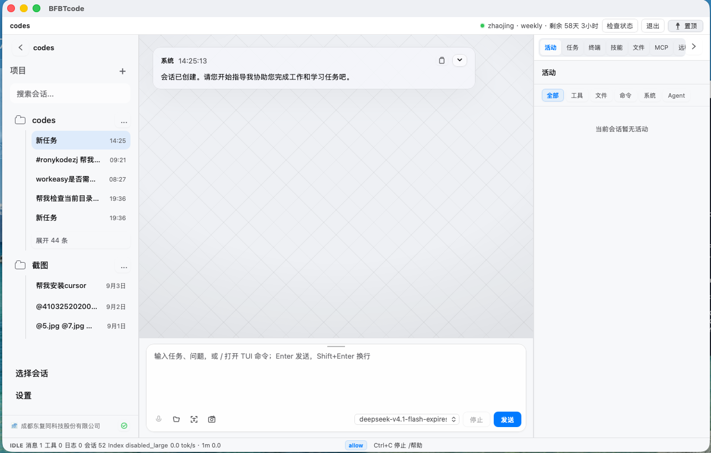
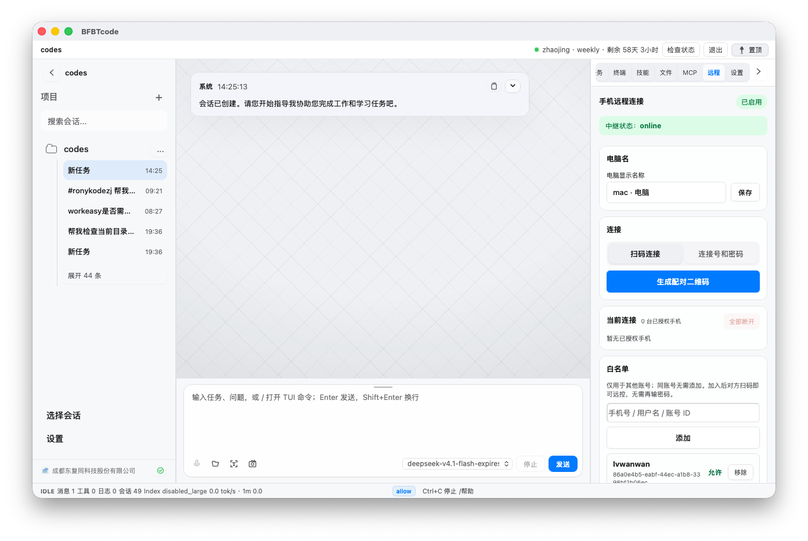
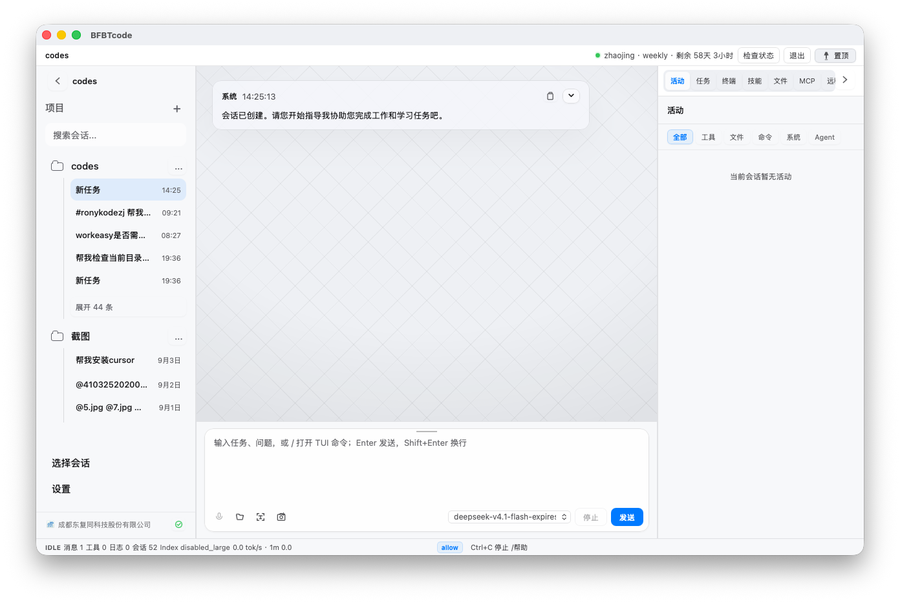
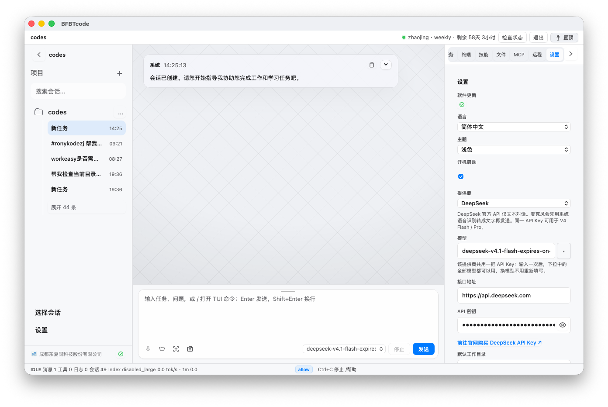

# BFBTCode 用户文档与安装包

BFBTCode（BFBT Code）是东复同科技面向写代码、学习和工作的 AI 编程助手。本仓库只提供**程序安装包、下载安装说明、登录说明、使用说明、Desktop 设置说明和会员说明**，不包含 BFBTCode 源代码。

官网：<https://www.dtrony.com>

## 快速开始

1. 在官网注册东复同账号（手机号 + 验证码）。同一套账号同时用于 BFBT Code 和 DTworkeasy。
2. 打开 [Releases](../../releases) 下载与你的系统匹配的安装包。
3. 按照 [安装说明](docs/install/README.md) 完成安装。
4. 阅读 [登录说明](docs/login/README.md)，用官网账号登录客户端。
5. 在设置中填写大模型 API Key，然后开始使用 [使用说明](docs/usage/README.md)。


## 界面截图

| | |
|:---:|:---:|
|  |  |
|  |  |

## 当前安装包（与官网一致）

最新 Release：[`v1.0.8.26102008`](https://github.com/dongfutong/BFBTCode/releases/tag/v1.0.8.26102008)

| 系统 | 软件 | 版本 | 文件 |
|---|---|---|---|
| Windows 10/11 64 位 | BFBT Code 桌面版 | 1.0.8.26102008 | `BFBTcode_1.0.8.26102008_x64_en-US.msi` |
| macOS Apple Silicon | BFBT Code 桌面版 | 1.0.8.26102009 | `BFBTcode_1.0.8.26102009_aarch64.dmg` |
| Linux x86_64 | BFBT Code 终端版（TUI） | 见下方一行安装 | 推荐 `install-tui.sh`；Release 亦附 `bfbtcodetui-linux-x86_64.tar.gz` |
| Android | DTworkeasy | 见独立仓库 | [DTworkeasy-Mobile](https://github.com/dongfutong/DTworkeasy-Mobile/releases) |
| Bridge / 配对 | DT Agent Bridge | 见独立仓库 | [DTworkeasy-Bridge](https://github.com/dongfutong/DTworkeasy-Bridge/releases) |

Linux TUI 官方推荐一行安装：

```
curl -fsSL 'https://www.dtrony.com/install-tui.sh' | sudo sh
```

## 文档语言

- [简体中文](i18n/zh-CN/README.md) · [Desktop 设置](i18n/zh-CN/desktop-settings.md)
- [English](i18n/en/README.md) · [Desktop Settings](i18n/en/desktop-settings.md)
- [繁體中文](i18n/zh-TW/README.md) · [Desktop 設定](i18n/zh-TW/desktop-settings.md)
- [日本語](i18n/ja/README.md) · [Desktop 設定](i18n/ja/desktop-settings.md)
- [한국어](i18n/ko/README.md) · [Desktop 설정](i18n/ko/desktop-settings.md)
- [Español](i18n/es/README.md) · [Desktop Ajustes](i18n/es/desktop-settings.md)
- [Português](i18n/pt/README.md) · [Desktop Configurações](i18n/pt/desktop-settings.md)
- [Русский](i18n/ru/README.md) · [Настройки Desktop](i18n/ru/desktop-settings.md)
- [العربية](i18n/ar/README.md) · [إعدادات Desktop](i18n/ar/desktop-settings.md)
- [हिन्दी](i18n/hi/README.md) · [Desktop सेटिंग्स](i18n/hi/desktop-settings.md)
- [বাংলা](i18n/bn/README.md) · [Desktop সেটিংস](i18n/bn/desktop-settings.md)
- [தமிழ்](i18n/ta/README.md) · [Desktop அமைப்புகள்](i18n/ta/desktop-settings.md)
- [བོད་སྐད](i18n/bo/README.md) · [Desktop སྒྲིག་སྟངས](i18n/bo/desktop-settings.md)
- [Bahasa Indonesia](i18n/id/README.md) · [Setelan Desktop](i18n/id/desktop-settings.md)

完整说明以简体中文和官网文档为准。

## 主要文档

- [安装](docs/install/README.md)
- [登录](docs/login/README.md)
- [第一次使用](docs/usage/README.md)
- [Desktop 设置](docs/settings/README.md)
- [会员权益](docs/token/README.md)
- [手机远控桌面版](docs/remote/desktop.md)
- [手机远控终端版](docs/remote/tui.md)
- [常见问题](docs/troubleshooting.md)
- [问题反馈](SUPPORT.md)

## 下载与镜像

官网下载中心：<https://www.dtrony.com>

GitHub：<https://github.com/dongfutong/BFBTCode>

Gitee：<https://gitee.com/dongfutong2026/bfbtcode>

两个仓库用于发布相同的用户文档和安装包。以 Releases 页面中的最新版本为准；版本号与官网下载中心保持一致。

## 安全提示

请勿在 Issue、截图、日志或聊天中公开密码、API Key、登录验证码或 Token。仓库维护者不会在文档中发布私人令牌。
