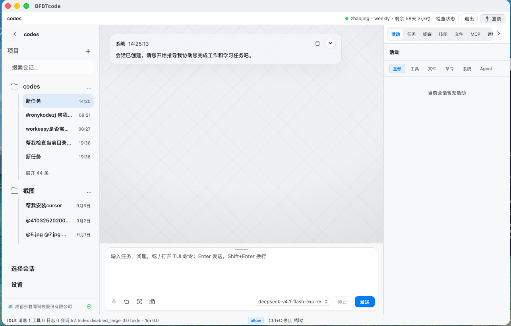
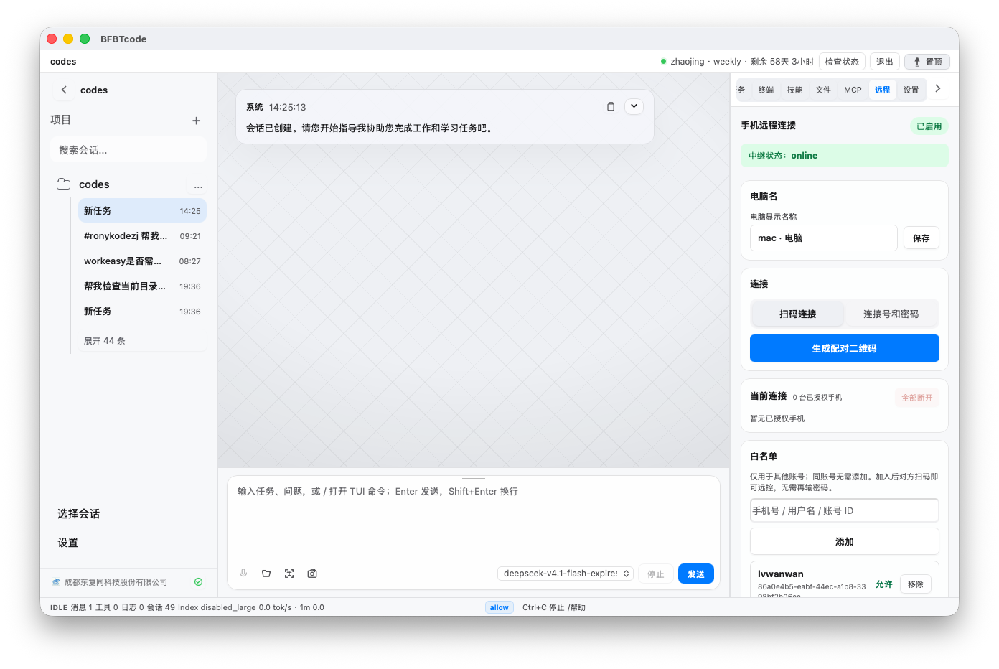
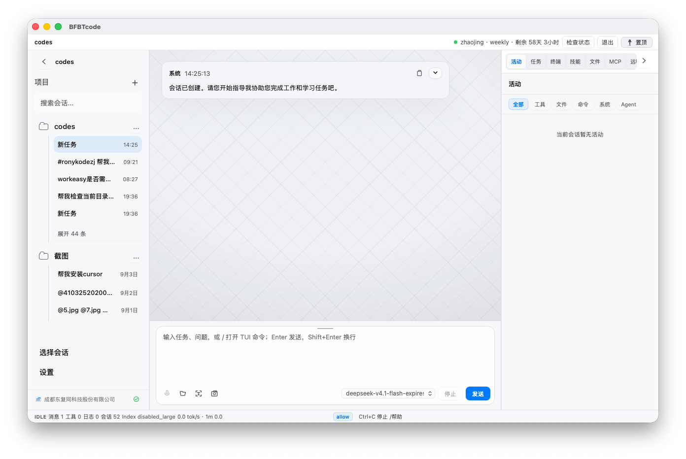
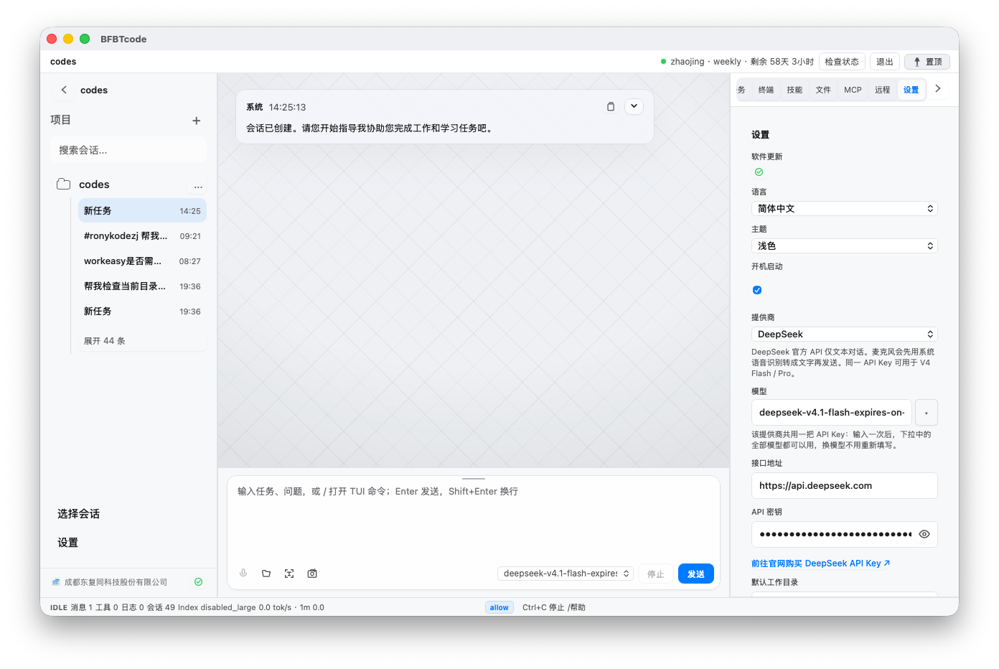
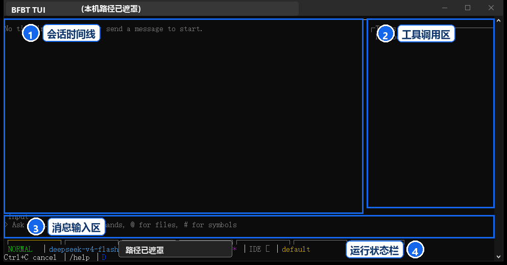

# BFBT Code — AI coding agent / AI 编程助手

**BFBT Code**（亦称 BFBTCode）是东复同科技推出的 **AI coding agent / coding assistant**，面向写代码、学习和日常工作。桌面版支持 **Windows** 与 **macOS（Apple Silicon）**，另有 **Linux** 终端版（TUI）。可用手机上的 [DTworkeasy](https://github.com/dongfutong/DTworkeasy-Mobile) 远控电脑里的 BFBT Code。

This repository publishes **installers and user documentation only** — not BFBT Code source code. Install BFBT Code, sign in, add your own model API key, and start a coding session on your machine.

| | |
|---|---|
| 官网 / Website | <https://www.dtrony.com> |
| 文档中心 / Docs | <https://www.dtrony.com/docs> |
| 下载 / Download | [GitHub Releases](https://github.com/dongfutong/BFBTCode/releases) · [官网下载中心](https://www.dtrony.com) |
| 会员 / Pricing | [会员权益](docs/token/README.md) · [官网定价](https://www.dtrony.com) |

BFBT Code 和 [BFBTbridge](https://github.com/dongfutong/BFBTbridge) 需要**试用或会员**有效期内才能使用；新用户注册后自动开通 **90 天试用**。DTworkeasy 注册即可免费使用。会员费不含大模型 Token，需自行配置 API Key。

## 快速开始

1. 在官网 <https://www.dtrony.com> 注册东复同账号（手机号 + 验证码）。同一套账号同时用于 BFBT Code 和 DTworkeasy。
2. 打开 [GitHub Releases](https://github.com/dongfutong/BFBTCode/releases) 或官网下载中心，下载与你的系统匹配的安装包。
3. 按照 [安装说明](docs/install/README.md) 完成安装。
4. 阅读 [登录说明](docs/login/README.md)，用官网账号登录客户端。
5. 在设置中填写大模型 API Key，然后开始使用 [使用说明](docs/usage/README.md)。

## 界面截图

| | |
|:---:|:---:|
|  |  |
|  |  |

Linux 终端版界面：



## 当前安装包（与官网一致）

最新 Release：[`v1.0.8.26102008`](https://github.com/dongfutong/BFBTCode/releases/tag/v1.0.8.26102008)

| 系统 | 软件 | 版本 | 文件 |
|---|---|---|---|
| Windows 10/11 64 位 | BFBT Code 桌面版 | 1.0.8.26102008 | `BFBTcode_1.0.8.26102008_x64_en-US.msi` |
| macOS Apple Silicon | BFBT Code 桌面版 | 1.0.8.26102009 | `BFBTcode_1.0.8.26102009_aarch64.dmg` |
| Linux x86_64 | BFBT Code 终端版（TUI） | 见下方一行安装 | 推荐 `install-tui.sh`；Release 亦附 `bfbtcodetui-linux-x86_64.tar.gz` |
| Android | DTworkeasy | 见独立仓库 | [DTworkeasy-Mobile](https://github.com/dongfutong/DTworkeasy-Mobile/releases) |
| iOS | DTworkeasy | App Store | [DTworkeasy on the App Store](https://apps.apple.com/cn/app/dtworkeasy/id6806894230) |
| Bridge / 配对 | BFBTbridge | 见独立仓库 | [BFBTbridge](https://github.com/dongfutong/BFBTbridge/releases) |

macOS 当前仅提供 Apple Silicon（aarch64）桌面版，要求 macOS 11 及以上；Intel Mac 暂未提供。Linux TUI 官方推荐一行安装：

```
curl -fsSL 'https://www.dtrony.com/install-tui.sh' | sudo sh
```

## 文档语言

- [简体中文](i18n/zh-CN/README.md) · [Desktop 设置](i18n/zh-CN/desktop-settings.md)
- [English](i18n/en/README.md) · [Desktop Settings](i18n/en/desktop-settings.md)
- [繁體中文](i18n/zh-TW/README.md) · [Desktop 設定](i18n/zh-TW/desktop-settings.md)
- [日本語](i18n/ja/README.md) · [Desktop 設定](i18n/ja/desktop-settings.md)
- [한국어](i18n/ko/README.md) · [Desktop 설정](i18n/ko/desktop-settings.md)
- [Español](i18n/es/README.md) · [Desktop Ajustes](i18n/es/desktop-settings.md)
- [Português](i18n/pt/README.md) · [Desktop Configurações](i18n/pt/desktop-settings.md)
- [Русский](i18n/ru/README.md) · [Настройки Desktop](i18n/ru/desktop-settings.md)
- [العربية](i18n/ar/README.md) · [إعدادات Desktop](i18n/ar/desktop-settings.md)
- [हिन्दी](i18n/hi/README.md) · [Desktop सेटिंग्स](i18n/hi/desktop-settings.md)
- [বাংলা](i18n/bn/README.md) · [Desktop সেটিংস](i18n/bn/desktop-settings.md)
- [தமிழ்](i18n/ta/README.md) · [Desktop அமைப்புகள்](i18n/ta/desktop-settings.md)
- [བོད་སྐད](i18n/bo/README.md) · [Desktop སྒྲིག་སྟངས](i18n/bo/desktop-settings.md)
- [Bahasa Indonesia](i18n/id/README.md) · [Setelan Desktop](i18n/id/desktop-settings.md)

完整说明以简体中文和 [官网文档](https://www.dtrony.com/docs) 为准。

## 主要文档

- [安装](docs/install/README.md)
- [登录](docs/login/README.md)
- [第一次使用](docs/usage/README.md)
- [Desktop 设置](docs/settings/README.md)
- [会员权益](docs/token/README.md)
- [手机远控桌面版](docs/remote/desktop.md)
- [手机远控终端版](docs/remote/tui.md)
- [常见问题](docs/troubleshooting.md)
- [问题反馈](SUPPORT.md)
- 官网文档中心：<https://www.dtrony.com/docs>
- 产品 FAQ：<https://www.dtrony.com/docs/faq>

## 下载与镜像

官网下载中心：<https://www.dtrony.com>

GitHub：<https://github.com/dongfutong/BFBTCode/releases>

Gitee：<https://gitee.com/dongfutong2026/bfbtcode>

两个仓库用于发布相同的用户文档和安装包。以 Releases 页面中的最新版本为准；版本号与官网下载中心保持一致。

## 安全提示

请勿在 Issue、截图、日志或聊天中公开密码、API Key、登录验证码或 Token。仓库维护者不会在文档中发布私人令牌。
