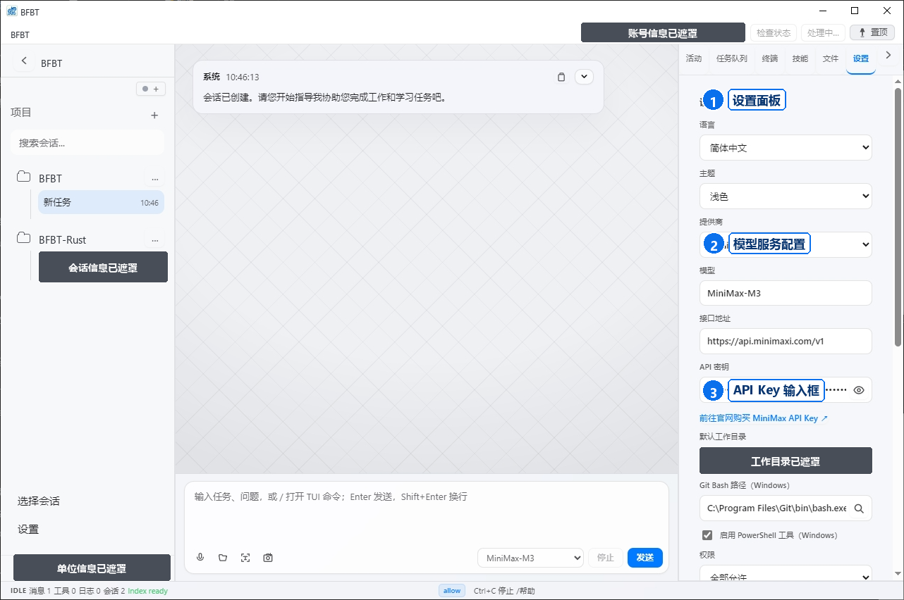

# Desktop 设置说明

Desktop 设置页面用于配置语言、账号、工作目录、模型服务和安全选项。

> 截图中的账号、路径和 API Key 均已脱敏。请勿直接照抄截图中的配置值。

## 语言

打开“设置→语言”，选择界面语言并按提示重新加载。当前 Desktop 支持：简体中文、繁體中文、English、日本語、한국어、Español、Português、Русский、العربية、हिन्दी、বাংলা、தமிழ்、བོད་སྐད、Bahasa Indonesia。

## 模型服务

在模型服务设置中选择服务商并填写服务地址、模型名称和 API Key（如果服务商要求）。API Key 只保存到自己的设备或官方支持的安全存储中，不要提交到仓库。

## 工作目录

选择需要协助的项目目录。只授予完成任务所需的目录权限；不要把密码库、私钥、生产环境配置或包含个人信息的目录作为工作目录。

## 权限与安全

对文件写入、命令执行、网络访问等操作逐项确认。发现异常行为时停止任务并保留脱敏日志。

## 账号与用量

账号区域可查看登录状态、Token 用量和退出登录。Token 购买方式见 [Token 说明](../token/README.md)。
