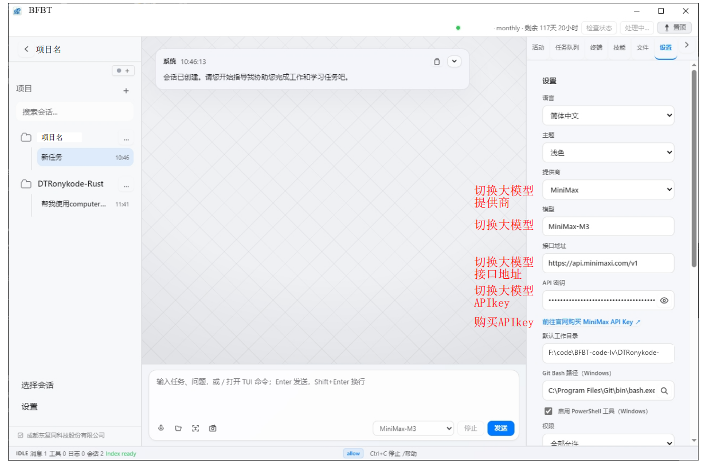

# Token 购买与使用说明

## Token 是什么

Token 是模型处理文本时使用的计量单位。不同模型、输入内容、输出长度和缓存策略会产生不同用量。Token 用量不等同于账号密码，也不等同于第三方模型服务商的 API Key。

## 购买流程

1. 在 BFBTCode Desktop 的账号或用量页面查看当前余额。
2. 进入页面提供的官方购买入口，选择套餐。
3. 按官方页面完成支付。
4. 返回 Desktop 刷新余额；到账时间以服务页面说明为准。

> 截图仅用于说明页面位置，图中的账号、API Key、订单信息和路径均已脱敏。购买前请以当前官方页面为准。

本仓库不保存支付链接、私人令牌或个人收款信息。请只使用 BFBTCode 官方页面显示的购买入口；遇到可疑链接请先停止操作。

## 购买后未到账

保留订单号和支付时间，向官方支持渠道反馈。不要提交完整 Token、银行卡信息、密码或身份证件；截图应先遮盖敏感信息。

## 安全须知

Token 一旦泄露应立即在账号页面撤销或更换。不要把 Token 写进源代码、公开 Issue、日志、截图或共享文档。
