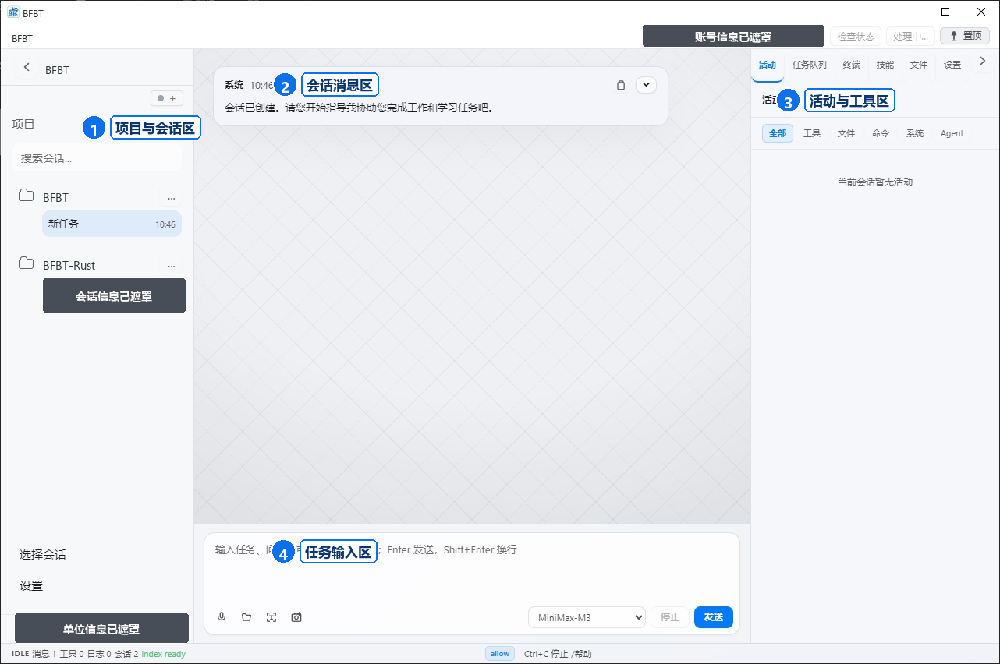
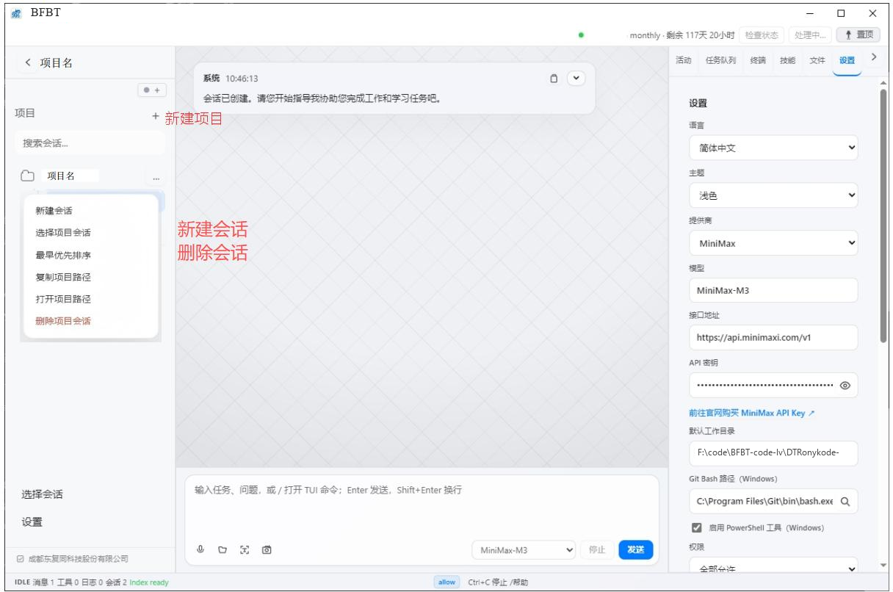
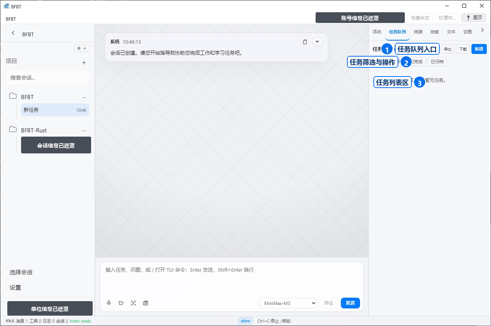
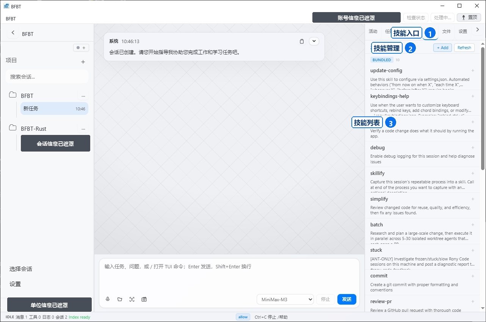
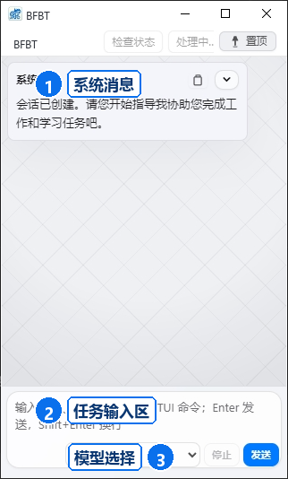
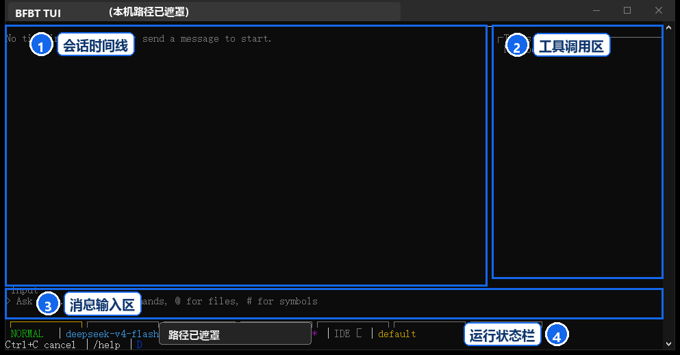

# 基本使用说明

## Desktop 界面

上图展示了会话区、任务输入区、活动与工具区以及设置入口。截图中的账号、项目路径和单位信息均已脱敏。

## 第一次对话

1. 打开 Desktop 并完成登录。
2. 选择或创建工作目录。
3. 在输入框描述任务，尽量说明目标、文件范围和期望结果。
4. 阅读模型提出的操作计划；涉及文件修改、命令执行或外部访问时，按页面提示确认。
5. 检查生成的差异和结果，再决定是否保留修改。

## 创建项目

使用“新建项目”创建项目会话，并在项目设置中确认模型、工作目录和权限。

## 任务队列

任务队列用于查看待处理、已完成和已归档的任务。长任务运行期间可从队列或会话中停止任务。

## 技能

技能页用于查看可用的辅助能力。启用技能前请确认其用途和所需权限。

## 小窗口模式与 TUI

小窗口模式适合快速发送任务；需要更完整的终端交互时可使用 TUI：

## 常用操作

- 新建会话：为不同任务建立独立上下文。
- 恢复会话：继续之前的工作。
- 附加文件：只选择完成任务所需的文件，避免上传敏感信息。
- 中止任务：任务运行期间使用停止按钮。
- 查看用量：在账号或状态区域查看 Token 用量。

BFBTCode 可能读取、修改项目文件或执行工具操作。请先备份重要文件，并审查模型输出。
